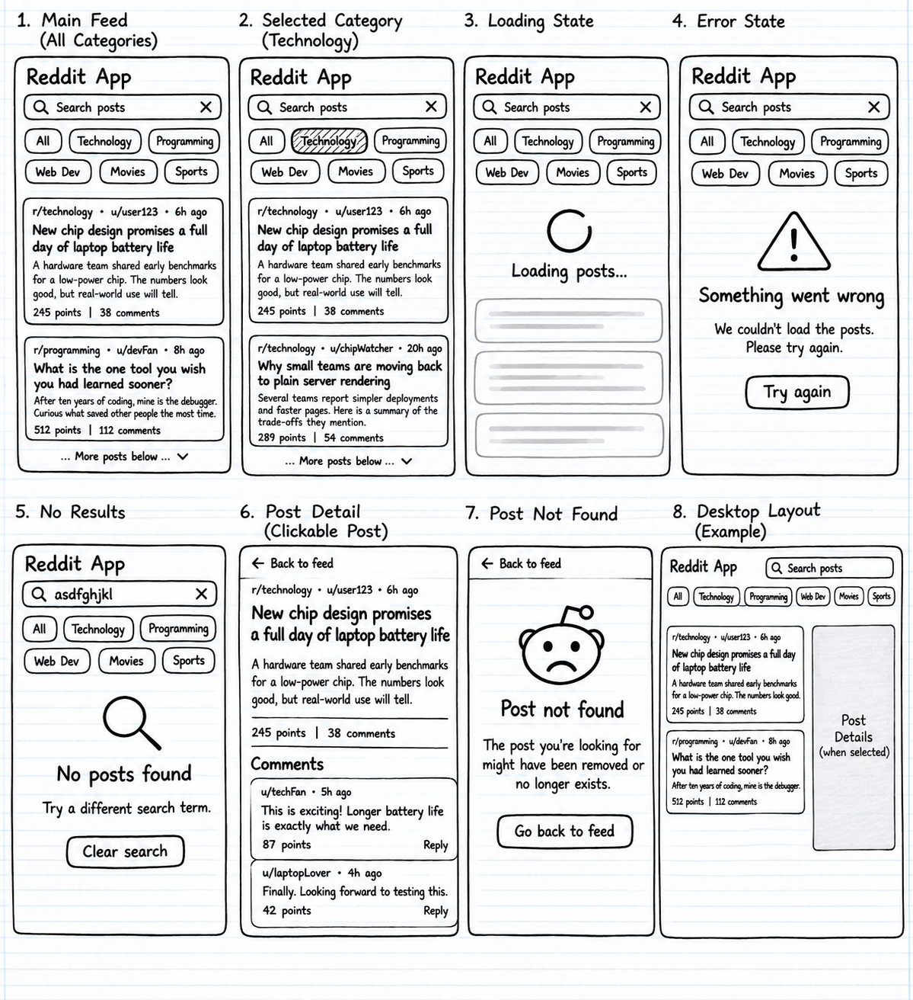
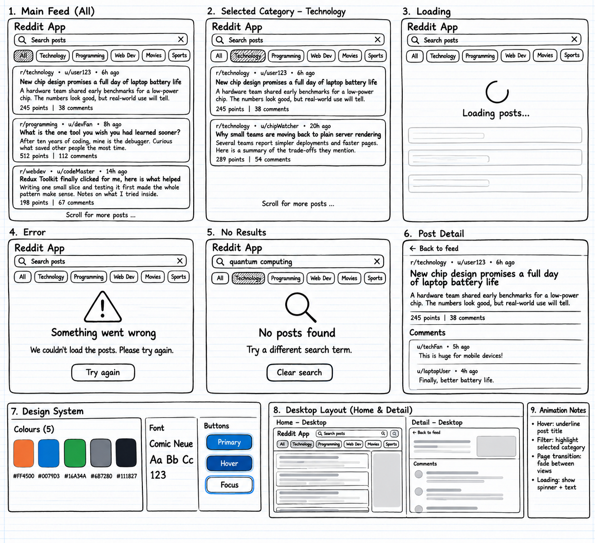
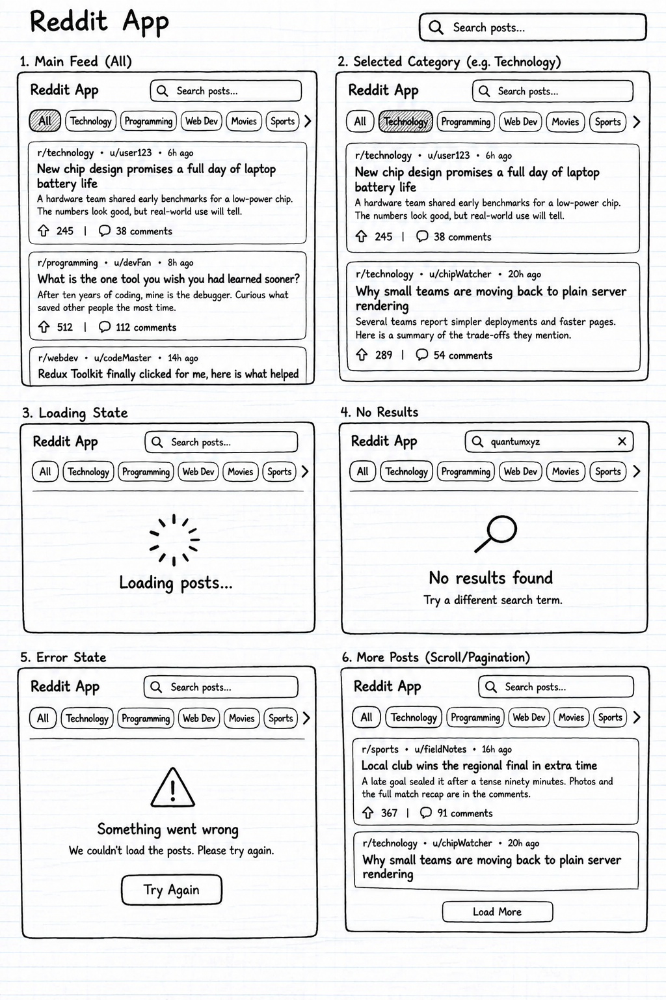

Reddit App

A small Reddit-style reader built with React and Redux. You can browse a feed of posts, search them, filter by category, and open a post to read its comments.

Live site: https://reddit-app-2026.netlify.app/

This is a portfolio project built for the Codecademy "Build Your Own Reddit App" brief.

About the data

The app does not call the live Reddit API. I started out planning to use Reddit's public .json endpoints, but Reddit blocks unauthenticated requests made from a browser, so the app could not rely on them.

Instead, the posts and comments come from a bundled snapshot of Reddit-shaped data. All of it sits behind two functions in src/api/redditApi.js, fetchPosts and fetchComments. They return promises, just as a network call would, so loading and error states work the same way they would with a live source. Pointing the app at a real API later means changing that one file.

Because the data is a snapshot, nothing in the app updates on its own, and the post scores and comment counts are fixed.

Features
A feed of posts shown as soon as the page opens, with subreddit, author, age, score and comment count on each card
Search by term across the posts
Category filters (All, Technology, Programming, Web Dev, Movies, Sports); the selected category is highlighted
A post detail page at /post/:id with the full text and its comments
Comment text written in Markdown is rendered properly
Loading, error, no-results and post-not-found states
Error states have a way out: "Try again" on a failed load, and "Back to feed" from a missing post
Layout that works from phone to desktop
A scroll-to-top button
Short animations (spinner, fade between views, cards rising in) that switch off for people who have asked their system to reduce motion
Wireframes

I drew the wireframes before building. The first sheet covers the core screens and states, the second adds the design system and animation notes, and the third refines the layout and sketches a "Load more" idea.

The build follows these closely. Where it differs: a post opens on its own page instead of in a side panel next to the feed.

Wireframes, first draft: feed, category, loading, error, no results, post detail, not found, desktop

Wireframes, second pass: screens, colour palette, typeface, button states, animation notes

Wireframes, third pass: feed layout, states and a "Load more" screen

The build follows these closely. Where it differs: a post opens on its own page instead of in a side panel next to the feed.

Design
Typeface: Comic Neue, loaded through @fontsource/comic-neue
Colours: orange #FF4500, blue #0079D3, green #16A34A, grey #6B7280 and near-black #111827
Buttons: distinct primary, hover and focus states, with a visible focus outline for keyboard users
Technologies
React 19
Redux Toolkit and React Redux for state (posts, comments and filters each have their own slice)
React Router 7 for the feed and post pages
react-markdown for comment text
Vite for development and builds
Vitest and React Testing Library for unit and component tests
Playwright for end-to-end tests
ESLint
Netlify for hosting
Project structure
docs/wireframes/   wireframe sheets
e2e/               Playwright end-to-end tests
src/
  api/             fetchPosts and fetchComments (the data source)
  app/             Redux store
  components/      shared pieces: CategoryBar, SearchBox, StatusPanel, ScrollToTop
  features/
    posts/         post list, cards, post page, slice, selectors, filtering
    comments/      comment list and slice
    filters/       search term and category slice
  utils/           small helpers such as formatTimeAgo

Each component, slice and helper has its test file next to it.

Getting started

You need Node.js 20 or later.

git clone https://github.com/Butiza-hub/reddit-app.git
cd reddit-app
npm install
npm run dev

Other scripts:

Command	What it does
npm test	Runs the unit and component tests with Vitest
npm run e2e	Runs the Playwright end-to-end tests
npm run lint	Runs ESLint
npm run build	Builds the app into dist/
npm run preview	Serves the production build locally

The first time you run the end-to-end tests you may need npx playwright install to download the browsers.

Testing

I wrote the tests first, one failing test at a time, and committed once each one passed.

Unit and component tests cover the Redux slices, selectors, filtering logic, the API functions and every component, including the loading, error and not-found states.
End-to-end tests (e2e/feed.spec.js and e2e/post.spec.js) cover searching, switching category, and opening a post.

The brief mentions Jest and Enzyme. I used Vitest and React Testing Library instead. Vitest works natively with Vite, and Enzyme has no official support for React 18 or later, so it could not be used with React 19.

Lighthouse

On the feed page, the scores were 98 / 100 / 100 / 91 on mobile and 100 / 100 / 100 / 91 on desktop (performance, accessibility, best practices, SEO).

Future work
Connect to live Reddit data through a small proxy or OAuth, with caching and handling for Reddit's rate limit of 10 requests per minute
A "Load more" button or infinite scroll for the feed (sketched in the third wireframe sheet)
Reply and vote controls on comments
More categories, and search that also covers comment text
A split layout on wide screens, with the post shown beside the feed
Installable progressive web app support
A custom domain
